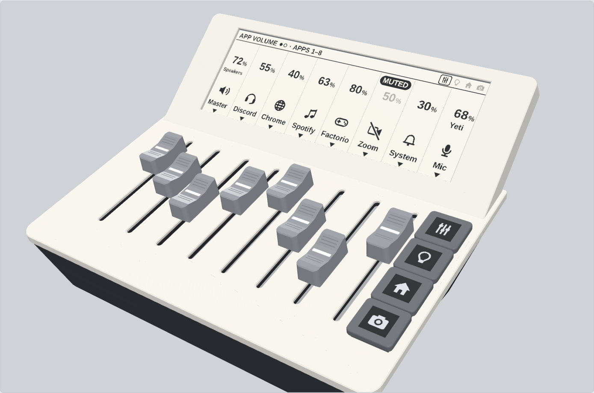
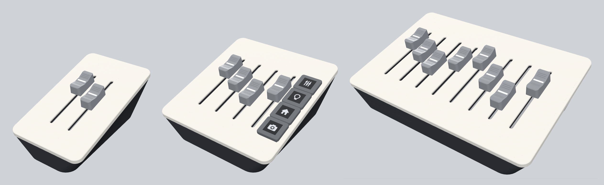
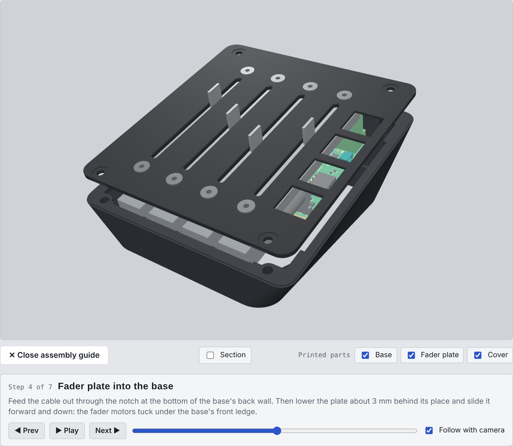

# FaderDeck

A 3D-printable desk controller for motorized faders: 2 to 8 faders, with or without a column of keys, or an eight-fader deck
with a 5.79" e-paper screen. Pick a size, turn it around in 3D, step through the build, and download the parts, all in your
browser.

### [▶ Open FaderDeck](https://scottbez1.github.io/FaderDeck/)

Every part prints without supports, and the site has the STLs for every size, the hardware list, an animated assembly guide and
a section tool for looking inside.

## Built on FaderBuddy

Every fader in a FaderDeck is driven by a [FaderBuddy](https://github.com/scottbez1/FaderBuddy): a small board that sits under a
60 mm motorized fader and does the hard part itself. It reads the fader's position, moves it with closed-loop motor control,
senses touch, and can even add haptic detents, all over I2C. There's no motor driver or PID loop to write per fader: a whole deck
is just faders on two I2C pins plus power, from any ESP32, and the [ESPHome component](https://github.com/scottbez1/FaderBuddy/blob/master/ABOUT_ESPHOME_INTEGRATION.md)
puts them in Home Assistant with a few lines of YAML.

FaderBuddy boards plug straight into one another with right-angle headers, which is why the FaderDeck's faders go in as one
chained block. Adding a fader is one more board.

What you'll need besides the printed parts and the hardware listed on the site:

- **FaderBuddy boards and faders**: available [pre-assembled from Bezek Labs](https://bezeklabs.etsy.com/listing/4506790932) in the
  US, with the firmware flashed and every board tested, and with 60 mm motorized faders as an add-on (buying there directly
  supports the project). Or build your own boards from the [FaderBuddy design files](https://github.com/scottbez1/FaderBuddy).
- **60 mm motorized faders, elsewhere**: Behringer MF60T, sold in 5-packs as replacement parts from music retailers like
  [Sweetwater](https://www.sweetwater.com/store/detail/MOTORFADER--behringer-mf60t-motorized-faders-set-of-5-for-motor-controllers)
  or [Amazon](https://www.amazon.com/Behringer-MOTOR-High-Performance-Faders-Keyboards/dp/B01DT827IC).
- **Touch-sensing fader caps** (optional): [conductive fader caps from Bezek Labs](https://bezeklabs.etsy.com/listing/4501804398)
  let the FaderBuddy feel your finger, so the motor never fights you.
- **For the screen deck**: an Elecrow CrowPanel ESP32 5.79" e-paper display.

Questions, or want to show off your build? The [FaderBuddy community Discord](https://discord.gg/xZXQAp5cue) is the place.

---

Want to help support development or just say "thanks"? Consider a one-time or monthly sponsorship:

| [:heart: Sponsor scottbez1 on GitHub](https://github.com/sponsors/scottbez1) |
|---|

**Using this project in a commercial setting or for paid client work?** Go right ahead, just follow the license terms below,
including attribution! I would, however, ask that you consider [sponsoring the project](https://github.com/sponsors/scottbez1).
Sponsorships allow me to pay for prototypes and development tools that make this project possible. Unlike pure software
projects, every iteration has real hardware costs; sponsorships allow me to keep iterating and improving this and other projects
faster. Thank you!

---

## License

The printable parts are licensed under [CC BY-SA 4.0](https://creativecommons.org/licenses/by-sa/4.0/): credit "FaderDeck, from
the FaderBuddy open-source project (github.com/scottbez1/FaderBuddy)", and share anything you make from them under the same
license. Models from other projects keep their own licenses; see [third_party/](third_party/README.md).

## Under the hood

The enclosure is designed in the same browser simulator the site shows, and the parts are generated from it, checked for
collisions against the real component models, and published by CI. [docs/TECHNICAL.md](docs/TECHNICAL.md) covers the repository,
the tool chain and the checks; [docs/DESIGN.md](docs/DESIGN.md) covers how the enclosure goes together and why.
